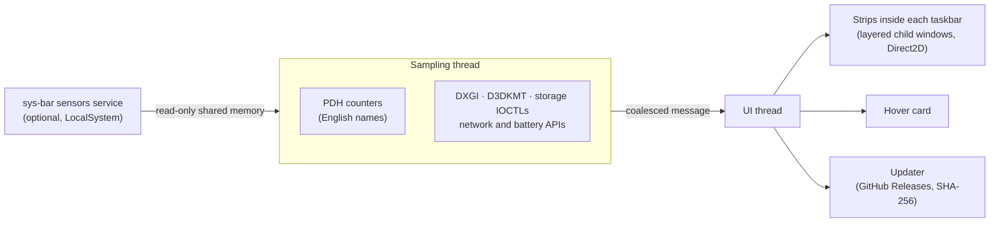

<p align="center">
  
</p>

<h3 align="center">Your system at a glance, right in the Windows taskbar.</h3>

<p align="center">
  CPU, memory, GPU, disks, network, temperatures and fans, next to the clock.<br>
  Native, tiny, and with the same numbers as Task Manager.
</p>

<p align="center">
  <a href="https://github.com/vitorpelegrini/sys-bar/releases/latest"></a>
  <a href="https://github.com/vitorpelegrini/sys-bar/releases"></a>
  <a href="https://github.com/vitorpelegrini/sys-bar/actions/workflows/ci.yml"></a>
  
  
  <a href="LICENSE"></a>
</p>

<p align="center"><b>English</b> · <a href="README.pt-BR.md">Português</a></p>

<p align="center">
  
</p>

---

## Contents

- [Why sys-bar](#why-sys-bar)
- [Features](#features)
- [Gallery](#gallery)
- [Install](#install)
- [Using it](#using-it)
- [Advanced sensors](#advanced-sensors)
- [Settings file](#settings-file)
- [Updates and security](#updates-and-security)
- [FAQ](#faq)
- [How it works](#how-it-works)
- [Building and testing](#building-and-testing)
- [Contributing](#contributing)
- [Code signing policy](#code-signing-policy)
- [License and acknowledgements](#license-and-acknowledgements)

## Why sys-bar

Task Manager tells you everything, but only once you open it. Desktop widgets and overlays get covered by
windows or cover them. sys-bar puts the numbers you glance at all day **inside the taskbar itself**, next to
the clock: always visible, never in the way, and costing about half a percent of one CPU core.

Hover it for a detailed card with one-minute graphs, temperatures and fans. Click it for Task Manager.
Right-click it for everything else.

## Features

### 📊 In the taskbar, not on top of it

- **Part of the taskbar.** It is a child window of the taskbar, not a floating overlay. It never hides behind
  it, follows auto-hide, stays out of full-screen apps, and on Windows 10 the task buttons move aside to make
  room, so nothing is covered.
- **Every monitor.** A strip on each taskbar, on Windows 10 and Windows 11, following monitors as they are
  plugged in and out. On Windows 11, where the clock has no window of its own, its position is measured
  through UI Automation, so the strip sits right next to it.
- **Fits any taskbar.** Vertical taskbars, small taskbar buttons, several rows, classic taskbars restored on
  Windows 11 (ExplorerPatcher, StartAllBack), per-monitor DPI.

### 🎯 Numbers you can trust

- **The same numbers as Task Manager.** CPU uses `% Processor Utility`. RAM is total minus available. GPU is the
  busiest engine of any GPU. VRAM is dedicated video memory. Disk activity is Task Manager's active time.
- **Every component.**
  - **CPU, memory, GPU and video memory**, with thin animated bars colored by load (amber above 80%,
    red above 92%).
  - **Disks**: one column per drive, labeled with its type and letter (`NVMe C:`, `SSD D:`, `HDD E:`,
    `USB F:`), or all combined; read and write speeds in the card.
  - **Network**: download and upload of the physical adapters, with the link speed (opt-in).
  - **Battery** on laptops: charge, charging state, power draw in watts and time left; amber at 20% and red
    at 10% when unplugged.

### 🌡️ Temperatures and fans

- **No driver needed** for GPU temperature and fan speed, or for NVMe drive temperatures.
- **Optional [advanced sensors](#advanced-sensors)** add CPU temperature, motherboard fans and SATA drive
  temperatures.
- **Thermometers** in the card: neutral while a device is comfortable, warming to yellow, amber and red as
  it heats up, with the warm and hot marks on the scale.
- **Fans matched to what they cool**: CPU, GPU, case, pump or power supply, with their speed and how hard
  they are driven (PWM duty). A GPU fan resting in zero-RPM mode shows as stopped. When a board names its fans
  generically, the **Fans** menu lets you say which is which.
- **Celsius or Fahrenheit**, automatic from the Windows region or chosen in the menu.

### ✨ Feels native

- **A detail card on hover**: hardware names, peaks and a one-minute graph per metric, organized in tiles,
  with the version and update status at the bottom. It always fits the screen and never cuts a word: long
  texts wrap, and on short screens it widens and shortens its graphs instead.
- **Fluent look**: Segoe UI, tabular figures (numbers never jitter), smooth animations, light, dark and
  high-contrast themes.
- **In your language**: English, Português, Español, Français, Deutsch, Italiano, Polski, Türkçe, Русский,
  Українська, 日本語, 한국어, 简体中文 and 繁體中文, following Windows by default.

### 🍃 Light and robust

- **One small native executable** (C++20, Win32, Direct2D), no runtime, no dependencies. Software rendering,
  so it never loads the GPU it measures; paused while the screen is off or the session is locked.
- **Measured, not promised.** Two minutes of normal use, sampling every second, on a 36-thread desktop:

  | | sys-bar | Sensors service (optional) | Together |
  | --- | --- | --- | --- |
  | CPU | 0.55% of one core | 0.27% of one core | **0.02% of the machine** |
  | Memory | 24 MB (9 MB private) | 52 MB (25 MB private) | **76 MB** |
  | GPU | 0.01% | 0% | **0.01%** |
  | Disk | 0 bytes read or written | 0 bytes | **0 bytes** |

  Animation frames repaint only the bars that moved (a few microseconds each), the network is read through
  the adapters in use rather than the whole interface table, and fans, which only the card shows, are read
  at full rate only while it is open.
- **Survives the real world**: Explorer restarts, driver resets, sleep and resume, DPI and display changes,
  monitors coming and going, drives plugged in and ejected.
- **Updates itself** from GitHub Releases, verified before anything runs (see
  [Updates and security](#updates-and-security)).

## Gallery

<p align="center">
  
  
</p>

<p align="center">
  <br>
  <sub>Light taskbar</sub>
</p>

<p align="center">
  <br>
  <sub>One column per drive, temperatures in Fahrenheit</sub>
</p>

<p align="center">
  <br>
  <sub>Network and battery</sub>
</p>

<p align="center">
  <br>
  <sub>On a laptop</sub>
</p>

## Install

Download the latest version from [**Releases**](https://github.com/vitorpelegrini/sys-bar/releases/latest):

| File | What it is |
| --- | --- |
| `sys-bar-x.y.z-setup.exe` | **Recommended.** Installer for x64 and ARM64. Per-user, no administrator rights. Options: start with Windows, advanced sensors. Updates itself. |
| `sys-bar-x.y.z-win-x64.zip` | Portable version. Unzip anywhere and run `sys-bar.exe`. |
| `sys-bar-x.y.z-win-arm64.zip` | Portable version for Windows on ARM (Snapdragon). |

Every file has a `.sha256` checksum next to it.

> [!NOTE]
> Until code signing is in place (see [Code signing policy](#code-signing-policy)), Windows SmartScreen may
> say "Windows protected your PC" the first time. Click **More info → Run anyway**.

**Requirements:** Windows 10 1809 or later, or Windows 11, on x64 or ARM64. The advanced sensors are x64 only.
Nothing else to install: sys-bar needs no runtime, and the sensors service runs on .NET Framework 4.7.2, which is part
of Windows since version 1809. The PawnIO driver ships inside the installer.

## Using it

| Action | Result |
| --- | --- |
| **Hover** | The detail card: graphs, hardware, temperatures, fans, version and update status |
| **Click** | Opens Task Manager (can be turned off) |
| **Right-click** | The menu below |

<details>
<summary><b>Everything in the menu</b></summary>

| Item | What it does |
| --- | --- |
| CPU, Memory, GPU, GPU memory, Disk, Network, Battery | Shows or hides each column (at least one always stays). |
| Show temperatures in the bar | Small temperature badges next to CPU, GPU and disk labels. |
| Disks | One column per drive, or all drives combined. |
| Temperature unit | Automatic (from the Windows region), Celsius or Fahrenheit. |
| Fans | What each motherboard fan cools, when the automatic guess is wrong for your board. |
| Update interval | 0.5, 1, 2 or 5 seconds. |
| Language | Automatic (Windows display language) or any of the 14 languages. |
| Updates | Status, check now, install automatically, install the available version. |
| Enable advanced sensors | Installs or removes the optional sensors service (one UAC prompt). |
| Highlight high load | Amber/red colors at high load and temperature. |
| Open Task Manager on click | Turns the click action on or off. |
| Show on all taskbars | With several monitors: a strip on each taskbar, or only on the main one. |
| Start with Windows | Starts sys-bar when you sign in. |

</details>

## Advanced sensors

Windows has no public API for CPU temperature or motherboard fans: reading them takes a kernel driver. sys-bar
offers an optional component for that:

- A small **`sys-bar sensors` service** built on [LibreHardwareMonitor](https://github.com/LibreHardwareMonitor/LibreHardwareMonitor),
  which supports a very wide range of hardware.
- The **[PawnIO](https://github.com/namazso/PawnIO) driver**, signed and open source, also used by
  FanControl and LibreHardwareMonitor.

Enable it in the installer or later from the menu (**Enable advanced sensors**); it asks for administrator
rights once. The service runs from `Program Files`, only reads sensors while sys-bar is showing them, and
publishes read-only data that sys-bar validates field by field. Turning it off from the menu removes it; PawnIO
is left in place because other tools share it.

## Settings file

Every option in the menu is saved to `%APPDATA%\sys-bar\settings.ini` (section `[sys-bar]`). You can also edit
it while sys-bar is closed:

| Key | Default | Meaning |
| --- | --- | --- |
| `ShowCpu`, `ShowRam`, `ShowGpu`, `ShowVram`, `ShowDisk` | `1` | Columns shown in the strip. |
| `ShowNet` | `0` | Network column (download/upload). |
| `ShowBattery` | `1` | Battery column (only ever shown on machines with a battery). |
| `ShowTemperatures` | `1` | Temperature badges in the strip. |
| `DisksSeparate` | `1` | One column per drive (`0`: all combined). Five or more drives are always combined. |
| `TemperatureUnit` | `auto` | `auto` (Windows region), `C` or `F`. |
| `FanRoles` | *(empty)* | Your corrections from the Fans menu, e.g. `Fan #1=case;Fan #2=cpu` (`cpu`, `gpu`, `case`, `pump`, `psu`). |
| `ColorByLoad` | `1` | Amber/red at high load and temperature. |
| `ClickOpensTaskManager` | `1` | Clicking the strip opens Task Manager. |
| `AllTaskbars` | `1` | A strip on the taskbar of every monitor. |
| `IntervalMs` | `1000` | Update interval in milliseconds (250–10000). |
| `OffsetDip` | `0` | Windows 11: extra space between the strip and the clock, e.g. to make room for widgets. |
| `Language` | `auto` | `auto` or `en`, `pt`, `es`, `fr`, `de`, `it`, `pl`, `tr`, `ru`, `uk`, `ja`, `ko`, `zh-Hans`, `zh-Hant`. |
| `CheckUpdates` | `1` | Look for a new release once a day. |
| `AutoUpdate` | `1` | Download, verify and install updates silently (installed copies). |

## Updates and security

sys-bar is built to be safe to leave running all day:

- **Updates are verified before they run.** Once a day sys-bar asks GitHub Releases for the latest version. An
  installed copy downloads the installer into a new private folder, checks its SHA-256 against the checksum
  published with the release, keeps the file locked so it cannot be swapped, and installs it silently at a
  quiet moment. Once releases are code-signed, an update must also carry the same signature as the running
  copy. A portable copy only shows a notice. You can check manually or turn this off under **Updates**.
- **No elevation by surprise.** sys-bar itself never needs administrator rights. The only elevated step is
  installing the optional sensors service, which trusts nothing from the per-user folder it starts from:
  every library must match a SHA-256 manifest built into the executable, and the PawnIO installer a pinned hash.
  Silent updates never ask for elevation.
- **A careful service.** The sensors service runs from `Program Files`, refuses named objects created by other
  accounts, updates itself only from the official release (verified, all-or-nothing, with rollback), and backs
  off after a failure.
- **No telemetry.** sys-bar sends nothing about you or your machine anywhere. Its only network traffic is the
  update check described above, which you can turn off.

Found a vulnerability? Please report it privately, as described in [SECURITY.md](SECURITY.md).

## FAQ

<details>
<summary><b>Do the numbers really match Task Manager?</b></summary>

Yes. sys-bar reads the same performance counters Task Manager uses, with the same aggregation. RAM and VRAM are
shown in GiB and labeled "GB", like Task Manager does.
</details>

<details>
<summary><b>Laptop with two GPUs?</b></summary>

The GPU percentage is the busiest GPU, so work on either one shows up. VRAM is the dedicated memory of the main
GPU; on integrated-only systems it is hidden, since they have no real dedicated memory.
</details>

<details>
<summary><b>Why is a fan labeled wrong?</b></summary>

Many motherboards only report generic names ("Fan #1", "Fan #2"). sys-bar then follows the reference wiring of
the board's sensor chip, which is right on most boards but not all. Right-click → **Fans** and set what each
one cools; your choice is remembered.
</details>

<details>
<summary><b>Some temperatures are missing.</b></summary>

Without the advanced sensors, Windows only exposes GPU and NVMe temperatures. CPU temperature, motherboard fans
and SATA drive temperatures need the [advanced sensors](#advanced-sensors).
</details>

<details>
<summary><b>The strip covers something on Windows 11.</b></summary>

Increase `OffsetDip` in the [settings file](#settings-file) to move it further from the clock, for example
when you use widgets or have many tray icons.
</details>

<details>
<summary><b>How do I uninstall it?</b></summary>

Use Windows Settings → Apps. It also removes the sensors service (one UAC prompt). For the portable version,
choose **Exit** in the menu and delete the folder.
</details>

<details>
<summary><b>Something is wrong. How do I get a log?</b></summary>

Exit sys-bar and start it with `SYSBAR_LOG` pointing to a file, then attach the file to a
[bug report](https://github.com/vitorpelegrini/sys-bar/issues/new/choose):

```powershell
$env:SYSBAR_LOG = "$env:TEMP\sys-bar.log"; & "$env:LOCALAPPDATA\Programs\sys-bar\sys-bar.exe"
```
</details>

## How it works



- **A sampling thread** reads PDH counters by their English names (so any Windows language works), DXGI and
  D3DKMT for GPUs, storage IOCTLs for drive type and temperature, IP Helper for the network and the battery
  driver for power. It never blocks the UI thread, which shares its input queue with the taskbar.
- **The strips** are layered child windows of each taskbar (`Shell_TrayWnd`, `Shell_SecondaryTrayWnd`). On
  classic taskbars they sit after the task list, which is shrunk to make room (and restored on exit, even
  after a crash); on Windows 11 they sit next to the clock.
- **The card** is drawn with Direct2D and DirectWrite, measured at its widest so it never jumps as values
  change.
- **The advanced sensors service** (C#, .NET Framework 4.7.2, LibreHardwareMonitorLib) publishes into a
  sequence-locked shared-memory block that sys-bar validates field by field.

## Building and testing

You need Visual Studio 2022 (C++ workload), CMake and the .NET SDK (for the sensors service).

```powershell
pwsh ./build.ps1                    # build, run the 112 unit tests, render previews of every theme and language
pwsh tools/test-taskbars.ps1        # multi-monitor integration test against stand-in taskbars
pwsh tools/package.ps1              # release artifacts: installer, portable zips, checksums
```

<details>
<summary><b>Project layout</b></summary>

```
src/            the app (C++20, Win32, Direct2D)
  app.*         taskbar integration, strips, card, menu
  metrics.*     sampling thread (PDH, DXGI, disks, network, battery)
  renderer.*    the strip;   card.*  the hover card
  logic.*       placement and pure decisions (unit-tested)
  update.*      self-update;  sensorfeed.*  reader of the sensors service
sensors/        the optional sensors service (C#, LibreHardwareMonitorLib + PawnIO)
tests/          unit tests, render previews, stand-in taskbars
packaging/      Inno Setup installer
tools/          packaging, screenshots, banner, integration and soak tests
```
</details>

## Contributing

Issues, translations and pull requests are welcome. Please read [CONTRIBUTING.md](CONTRIBUTING.md) and the
[code of conduct](CODE_OF_CONDUCT.md). The project follows [Semantic Versioning](https://semver.org/); every
change is listed in the [CHANGELOG](CHANGELOG.md).

## Code signing policy

Free code signing provided by [SignPath.io](https://about.signpath.io), certificate by
[SignPath Foundation](https://signpath.org) (application in progress; until it is approved, releases are not
signed).

- **Committers and reviewers:** [Vitor Pelegrini de Souza](https://github.com/vitorpelegrini)
- **Approvers:** [Vitor Pelegrini de Souza](https://github.com/vitorpelegrini)

Only binaries built by this repository's [release workflow](.github/workflows/release.yml) from a tagged commit
are submitted for signing.

**Privacy policy:** this program will not transfer any information to other networked systems unless
specifically requested by the user or the person installing or operating it. The only network access is the
update check against GitHub Releases (and, for the optional sensors service, the download of its own update
package), which can be turned off in the menu.

## License and acknowledgements

[MIT](LICENSE) © 2026 Vitor Pelegrini de Souza.

sys-bar stands on the work of [LibreHardwareMonitor](https://github.com/LibreHardwareMonitor/LibreHardwareMonitor)
(MPL-2.0) and [PawnIO](https://github.com/namazso/PawnIO) (GPL-2.0, installed separately); see
[THIRD-PARTY-NOTICES.md](THIRD-PARTY-NOTICES.md).
