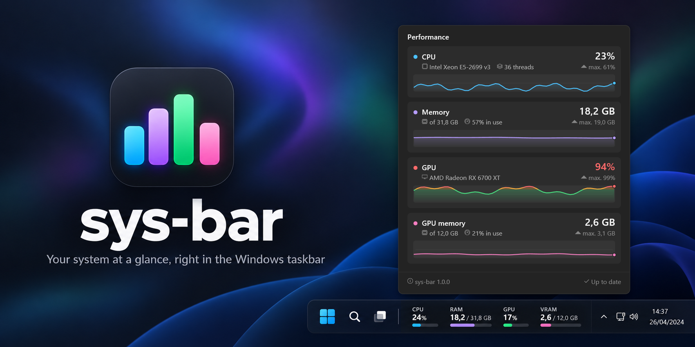
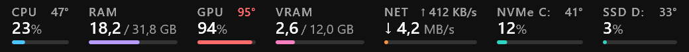
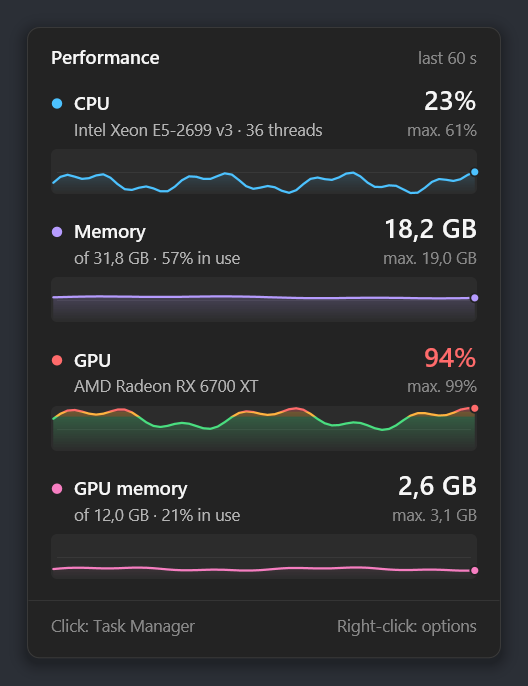
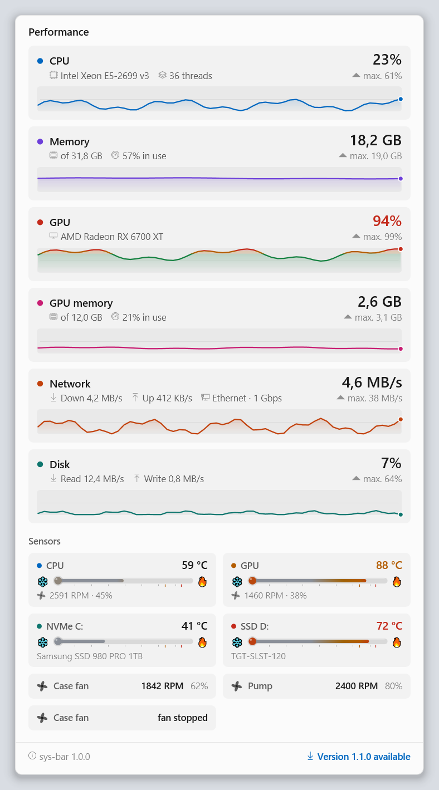

<p align="center">
  
</p>

<p align="center">
  <b>Uso de CPU, RAM, GPU e VRAM ao lado do relógio.</b><br>
  Nativo, leve, e com os mesmos números do Gerenciador de Tarefas.
</p>

<p align="center">
  <a href="https://github.com/vitorpelegrini/sys-bar/actions/workflows/ci.yml"></a>
  <a href="https://github.com/vitorpelegrini/sys-bar/releases/latest"></a>
  <a href="https://github.com/vitorpelegrini/sys-bar/releases"></a>
  
  <a href="LICENSE"></a>
</p>

<p align="center"><a href="README.md">English</a> · <b>Português</b></p>

---

<p align="center">
  
</p>

## Recursos

- **Mora dentro da barra de tarefas.** É parte da própria barra, não uma janela flutuante: nunca
  fica atrás dela, acompanha a ocultação automática e some em tela cheia. No Windows 10 os botões
  de tarefas abrem espaço, então nada fica coberto.
- **Os mesmos números do Gerenciador de Tarefas.** A CPU usa `% Processor Utility`. A RAM é o
  total menos o disponível. A GPU é o engine mais ocupado de qualquer GPU. A VRAM é a memória de
  vídeo dedicada.
- **Disco e temperaturas.** Atividade de disco com leitura/gravação em MB/s. Cada disco tem a sua coluna,
  identificada pelo tipo e pela letra (`NVMe C:`, `SSD D:`, `HDD E:`); pelo menu dá para juntar todos em uma.
  As temperaturas aparecem em pequenos badges na faixa, e o card tem uma seção de sensores. Celsius ou
  Fahrenheit: automático pela região do Windows, ou escolhido no menu.
  - Temperatura e fan da GPU, e temperatura dos NVMe, sem precisar de driver.
  - Os **sensores avançados** opcionais acrescentam a temperatura da CPU, as fans da placa-mãe e de
    controladoras e a temperatura de discos SATA (veja abaixo).
- **Se atualiza sozinho.** Consulta as Releases do GitHub uma vez por dia. As atualizações são verificadas por
  SHA-256 e instaladas em silêncio.
- **Card ao passar o mouse.** Mostra o modelo do hardware, os picos e um gráfico do último minuto
  para cada métrica. O histórico acima de 80% / 92% de carga fica âmbar / vermelho.
- **Leve.** Um único `.exe` nativo de ~500 KB (C++20, Win32, Direct2D), sem dependências.
  - Cerca de 0,5% de um núcleo de CPU e 12 MB de RAM.
  - Desenho por software, para não pesar na GPU que está medindo.
  - Pausa com a tela desligada.
- **Visual nativo.**
  - Segoe UI, algarismos tabulares (os números não tremem) e animações suaves.
  - Temas claro, escuro e alto contraste, e DPI por monitor.
- **No seu idioma.** English, Português, Español, Français, Deutsch, Italiano, Polski, Türkçe,
  Русский, Українська, 日本語, 한국어, 简体中文 e 繁體中文.
- **Robusto.**
  - Sobrevive a reinícios do Explorer, resets do driver, suspensão e mudanças de DPI e de tela.
  - Funciona com barra vertical e botões pequenos.
  - Funciona com a barra clássica restaurada no Windows 11 (ExplorerPatcher, StartAllBack).

<p align="center">
  
  
</p>

## Instalação

Baixe a versão mais recente em [**Releases**](https://github.com/vitorpelegrini/sys-bar/releases/latest):

| Arquivo | O que é |
| --- | --- |
| `sys-bar-x.y.z-setup.exe` | Instalador para x64 e ARM64. Por usuário, sem precisar de administrador; opção "iniciar com o Windows". |
| `sys-bar-x.y.z-win-x64.zip` | Versão portátil. Descompacte em qualquer pasta e rode o `sys-bar.exe`. |
| `sys-bar-x.y.z-win-arm64.zip` | Versão portátil para Windows em ARM (Snapdragon). |

Cada arquivo vem com o checksum `.sha256`. Os executáveis ainda não têm assinatura digital, então
na primeira vez o SmartScreen pode mostrar "O Windows protegeu o computador". Clique em
**Mais informações → Executar assim mesmo**.

Requer Windows 10 1809 ou mais recente, ou Windows 11.

## Uso

| Ação | Resultado |
| --- | --- |
| Passar o mouse | Card de detalhes com gráficos de histórico |
| Clique | Abre o Gerenciador de Tarefas (dá para desligar) |
| Clique direito | Opções: métricas, intervalo, idioma, destaque de carga alta, comportamento do clique, iniciar com o Windows, sair |

### Arquivo de configurações

Todas as opções do menu ficam salvas em `%APPDATA%\sys-bar\settings.ini`. O arquivo também tem
algumas chaves extras:

| Chave | Padrão | Significado |
| --- | --- | --- |
| `IntervalMs` | `1000` | Intervalo de atualização em milissegundos (250–10000). |
| `OffsetDip` | `0` | Windows 11: espaço extra entre a faixa e a área de notificação. Aumente se a faixa cobrir algo, como os widgets. |
| `Language` | `auto` | `auto` ou um código: `en`, `pt`, `es`, `fr`, `de`, `it`, `pl`, `tr`, `ru`, `uk`, `ja`, `ko`, `zh-Hans`, `zh-Hant`. |
| `CheckUpdates` | `1` | Procura uma nova versão uma vez por dia. |
| `AutoUpdate` | `1` | Baixa, verifica (SHA-256) e instala atualizações em silêncio (só na versão instalada). |

## Sensores avançados

O Windows não tem API pública para a temperatura da CPU nem para as fans da placa-mãe: ler esses dados
exige um driver. O sys-bar pode adicionar um componente opcional para isso:

- Um pequeno serviço `sys-bar sensors`, baseado no [LibreHardwareMonitor](https://github.com/LibreHardwareMonitor/LibreHardwareMonitor),
  que suporta uma enorme variedade de hardware.
- O driver [PawnIO](https://github.com/namazso/PawnIO). Ele é assinado e open source, e também é usado
  pelo FanControl e pelo LibreHardwareMonitor.

Dá para ativar no instalador ou depois pelo menu (**Ativar sensores avançados**). Ele pede permissão de
administrador uma única vez. O serviço roda de `Program Files`, quase não usa CPU e só lê os sensores
enquanto o sys-bar os está mostrando. Desativar pelo menu o remove. Disponível só em x64.

## Perguntas frequentes

**Os números batem mesmo com o Gerenciador de Tarefas?**
Sim. O sys-bar lê os mesmos contadores de desempenho que ele, com a mesma agregação. RAM e VRAM
aparecem em GiB, com o rótulo "GB", como faz o Gerenciador.

**Notebook com duas GPUs?**
A % de GPU é a da GPU mais ocupada, então o trabalho aparece seja na integrada ou na dedicada. A
VRAM é a memória dedicada da GPU principal. Em sistemas só com GPU integrada, a VRAM fica oculta,
porque não existe memória dedicada de verdade.

**Como funcionam as atualizações?**
Uma vez por dia o sys-bar consulta as Releases do GitHub. Quando há versão nova:
- A versão instalada baixa o instalador e confere o SHA-256. Depois instala em silêncio num momento
  tranquilo: a faixa some por um segundo e volta atualizada.
- A versão portátil mostra um aviso com o link para baixar.

O serviço de sensores avançados acompanha sozinho. Ele baixa o próprio pacote, verificado, da mesma release,
sem pedir UAC.

Dá para procurar manualmente ou desligar isso em **Atualizações**, no menu.

**Vários monitores?**
O sys-bar aparece na barra de tarefas do monitor principal.

**Como desinstalo?**
Pelo Windows, em Configurações → Aplicativos. Na versão portátil, escolha **Sair** no menu e apague
a pasta.

**Algo deu errado. Como gero um log?**
Feche o sys-bar e abra de novo com a variável `SYSBAR_LOG` apontando para um arquivo. Depois anexe
esse arquivo a um [relato de bug](https://github.com/vitorpelegrini/sys-bar/issues/new/choose):

```powershell
$env:SYSBAR_LOG = "$env:TEMP\sys-bar.log"; & "$env:LOCALAPPDATA\Programs\sys-bar\sys-bar.exe"
```

## Como funciona

- **Thread de coleta.** Lê os contadores PDH (pelos nomes em inglês, para funcionar em qualquer
  idioma do Windows), o DXGI e o `GlobalMemoryStatusEx`. Ela só posta mensagens para a thread de
  interface, que nunca espera.
- **A faixa.** É uma janela filha em camadas da própria barra (`Shell_TrayWnd`).
  - Nas barras clássicas, fica no ReBar, logo depois da lista de tarefas, que é encolhida para
    abrir espaço sem cobrir as outras barras de ferramentas.
  - No Windows 11, fica ao lado da área de notificação.
- **As partes puras têm testes unitários** (66 testes): geometria, formatação, agregação da GPU e
  traduções. Os testes também geram prévias de todos os temas, escalas e idiomas.

Os detalhes estão em [CONTRIBUTING.md](CONTRIBUTING.md) (em inglês).

## Compilar

```powershell
pwsh ./build.ps1          # Visual Studio 2022 (carga de trabalho C++) + CMake
```

## Contribuindo

Issues, traduções e pull requests são muito bem-vindos. Veja o [CONTRIBUTING.md](CONTRIBUTING.md)
e o [código de conduta](CODE_OF_CONDUCT.md). O projeto segue o
[Versionamento Semântico](https://semver.org/lang/pt-BR/), e as mudanças ficam no
[CHANGELOG.md](CHANGELOG.md).

## Licença

[MIT](LICENSE) © 2026 Vitor Pelegrini de Souza
