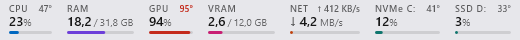
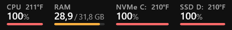
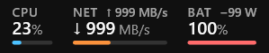
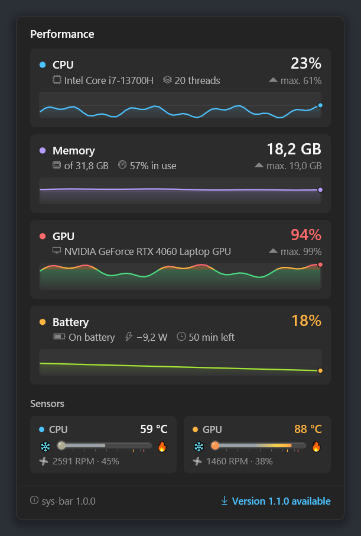
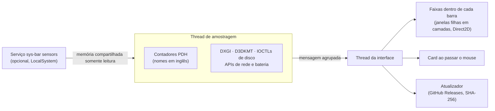

<p align="center">
  
</p>

<h3 align="center">Seu sistema num relance, direto na barra de tarefas do Windows.</h3>

<p align="center">
  CPU, memória, GPU, discos, rede, temperaturas e fans, ao lado do relógio.<br>
  Nativo, leve e com os mesmos números do Gerenciador de Tarefas.
</p>

<p align="center">
  <a href="https://github.com/vitorpelegrini/sys-bar/releases/latest"></a>
  <a href="https://github.com/vitorpelegrini/sys-bar/releases"></a>
  <a href="https://github.com/vitorpelegrini/sys-bar/actions/workflows/ci.yml"></a>
  
  
  <a href="LICENSE"></a>
</p>

<p align="center"><a href="README.md">English</a> · <b>Português</b></p>

<p align="center">
  
</p>

---

## Sumário

- [Por que o sys-bar](#por-que-o-sys-bar)
- [Recursos](#recursos)
- [Galeria](#galeria)
- [Instalação](#instalação)
- [Como usar](#como-usar)
- [Sensores avançados](#sensores-avançados)
- [Arquivo de configurações](#arquivo-de-configurações)
- [Atualizações e segurança](#atualizações-e-segurança)
- [Perguntas frequentes](#perguntas-frequentes)
- [Como funciona](#como-funciona)
- [Compilar e testar](#compilar-e-testar)
- [Como contribuir](#como-contribuir)
- [Política de assinatura de código](#política-de-assinatura-de-código)
- [Licença e agradecimentos](#licença-e-agradecimentos)

## Por que o sys-bar

O Gerenciador de Tarefas mostra tudo, mas só quando você o abre. Widgets e overlays ficam atrás das janelas ou
na frente delas. O sys-bar coloca os números que você confere o dia inteiro **dentro da própria barra de
tarefas**, ao lado do relógio: sempre visíveis, nunca no caminho, e custando cerca de meio por cento de um
núcleo de CPU.

Passe o mouse para ver um card detalhado com gráficos do último minuto, temperaturas e fans. Clique para abrir o
Gerenciador de Tarefas. Botão direito para todo o resto.

## Recursos

### 📊 Dentro da barra de tarefas, não por cima dela

- **Parte da barra.** É uma janela filha da barra de tarefas, não um overlay flutuante. Nunca fica atrás dela,
  acompanha a ocultação automática, some em tela cheia e, no Windows 10, os botões de tarefas abrem espaço,
  então nada fica coberto.
- **Todos os monitores.** Uma faixa em cada barra de tarefas, no Windows 10 e no Windows 11, acompanhando os
  monitores conforme são conectados e desconectados. No Windows 11, onde o relógio não tem janela própria, a
  posição dele é medida por UI Automation, e a faixa fica colada nele.
- **Em qualquer barra.** Barra vertical, botões pequenos, várias linhas, barra clássica restaurada no
  Windows 11 (ExplorerPatcher, StartAllBack), DPI por monitor.

### 🎯 Números confiáveis

- **Os mesmos números do Gerenciador de Tarefas.** A CPU usa `% Processor Utility`. A RAM é o total menos o
  disponível. A GPU é o engine mais ocupado de qualquer GPU. A VRAM é a memória de vídeo dedicada. A atividade
  de disco é o "tempo ativo" do Gerenciador.
- **Todos os componentes.**
  - **CPU, memória, GPU e memória de vídeo**, com barrinhas animadas coloridas pela carga (âmbar acima de
    80%, vermelho acima de 92%).
  - **Discos**: uma coluna por disco, identificada pelo tipo e pela letra (`NVMe C:`, `SSD D:`, `HDD E:`,
    `USB F:`), ou todos juntos; leitura e gravação no card.
  - **Rede**: download e upload dos adaptadores físicos, com a velocidade do link (opcional).
  - **Bateria** em notebooks: carga, se está carregando, consumo em watts e tempo restante; âmbar em 20% e
    vermelho em 10% fora da tomada.

### 🌡️ Temperaturas e fans

- **Sem driver** para a temperatura e a fan da GPU, e para a temperatura dos NVMe.
- **[Sensores avançados](#sensores-avançados) opcionais** acrescentam a temperatura da CPU, as fans da
  placa-mãe e a temperatura de discos SATA.
- **Termômetros** no card: neutros enquanto a peça está tranquila, esquentando para amarelo, âmbar e vermelho,
  com as marcas de "quente" e "muito quente" na escala.
- **Fans associadas ao que resfriam**: CPU, GPU, gabinete, bomba ou fonte, com a rotação e o quanto estão sendo
  acionadas (PWM). A fan da GPU parada no modo zero RPM aparece como parada. Quando a placa dá nomes
  genéricos, o menu **Fans** deixa você dizer qual é qual.
- **Celsius ou Fahrenheit**, automático pela região do Windows ou escolhido no menu.

### ✨ Visual nativo

- **Um card de detalhes ao passar o mouse**: nomes do hardware, picos e um gráfico do último minuto por
  métrica, organizados em blocos, com a versão e o status de atualização no rodapé. Sempre cabe na tela e
  nunca corta uma palavra: textos longos quebram linha e, em telas baixas, o card alarga e encurta os gráficos.
- **Visual Fluent**: Segoe UI, algarismos tabulares (os números não tremem), animações suaves, temas claro,
  escuro e alto contraste.
- **No seu idioma**: English, Português, Español, Français, Deutsch, Italiano, Polski, Türkçe, Русский,
  Українська, 日本語, 한국어, 简体中文 e 繁體中文, seguindo o Windows por padrão.

### 🍃 Leve e robusto

- **Um único executável nativo pequeno** (C++20, Win32, Direct2D), sem runtime nem dependências. Desenho por
  software, para não pesar na GPU que está medindo; pausa com a tela desligada ou a sessão bloqueada.
- **Medido, não prometido.** Dois minutos de uso normal, medindo a cada segundo, num desktop de 36 threads:

  | | sys-bar | Serviço de sensores (opcional) | Juntos |
  | --- | --- | --- | --- |
  | CPU | 0,55% de um núcleo | 0,27% de um núcleo | **0,02% da máquina** |
  | Memória | 24 MB (9 MB exclusivos) | 52 MB (25 MB exclusivos) | **76 MB** |
  | GPU | 0,01% | 0% | **0,01%** |
  | Disco | 0 bytes lidos ou gravados | 0 bytes | **0 bytes** |

  Os quadros de animação redesenham só as barrinhas que se mexeram (alguns microssegundos cada), a rede é
  lida pelas placas em uso em vez da tabela inteira de interfaces, e as fans, que só aparecem no card, são
  lidas a cada segundo só enquanto ele está aberto.
- **Aguenta o mundo real**: Explorer reiniciando, driver de vídeo resetando, suspensão, mudanças de DPI e de
  tela, monitores e discos conectados e removidos.
- **Se atualiza sozinho** pelas Releases do GitHub, verificando tudo antes de rodar (veja
  [Atualizações e segurança](#atualizações-e-segurança)).

## Galeria

<p align="center">
  
  
</p>

<p align="center">
  <br>
  <sub>Barra de tarefas clara</sub>
</p>

<p align="center">
  <br>
  <sub>Uma coluna por disco, temperaturas em Fahrenheit</sub>
</p>

<p align="center">
  <br>
  <sub>Rede e bateria</sub>
</p>

<p align="center">
  <br>
  <sub>Num notebook</sub>
</p>

## Instalação

Baixe a versão mais recente em [**Releases**](https://github.com/vitorpelegrini/sys-bar/releases/latest):

| Arquivo | O que é |
| --- | --- |
| `sys-bar-x.y.z-setup.exe` | **Recomendado.** Instalador para x64 e ARM64. Por usuário, sem permissão de administrador. Opções: iniciar com o Windows, sensores avançados. Se atualiza sozinho. |
| `sys-bar-x.y.z-win-x64.zip` | Versão portátil. Descompacte onde quiser e rode o `sys-bar.exe`. |
| `sys-bar-x.y.z-win-arm64.zip` | Versão portátil para Windows em ARM (Snapdragon). |

Cada arquivo tem um checksum `.sha256` ao lado.

> [!NOTE]
> Até a assinatura de código estar ativa (veja a [política de assinatura](#política-de-assinatura-de-código)),
> o SmartScreen do Windows pode mostrar "O Windows protegeu o computador" na primeira vez. Clique em
> **Mais informações → Executar assim mesmo**.

**Requisitos:** Windows 10 1809 ou mais recente, ou Windows 11, em x64 ou ARM64. Os sensores avançados são só
para x64. Não há nada mais para instalar: o sys-bar não usa runtime, e o serviço de sensores roda no .NET Framework
4.7.2, que já faz parte do Windows desde a versão 1809. O driver PawnIO vem dentro do instalador.

## Como usar

| Ação | Resultado |
| --- | --- |
| **Passar o mouse** | O card de detalhes: gráficos, hardware, temperaturas, fans, versão e status de atualização |
| **Clicar** | Abre o Gerenciador de Tarefas (dá para desligar) |
| **Botão direito** | O menu abaixo |

<details>
<summary><b>Tudo o que tem no menu</b></summary>

| Item | O que faz |
| --- | --- |
| CPU, Memória, GPU, Memória da GPU, Disco, Rede, Bateria | Mostra ou esconde cada coluna (pelo menos uma sempre fica). |
| Mostrar temperaturas na barra | Pequenos indicadores de temperatura ao lado de CPU, GPU e discos. |
| Discos | Uma coluna por disco, ou todos juntos. |
| Unidade de temperatura | Automática (pela região do Windows), Celsius ou Fahrenheit. |
| Fans | O que cada fan da placa-mãe resfria, quando o palpite automático erra para a sua placa. |
| Intervalo de atualização | 0,5, 1, 2 ou 5 segundos. |
| Idioma | Automático (idioma do Windows) ou qualquer um dos 14 idiomas. |
| Atualizações | Status, verificar agora, instalar automaticamente, instalar a versão disponível. |
| Ativar sensores avançados | Instala ou remove o serviço opcional de sensores (um prompt do UAC). |
| Destacar carga alta | Cores âmbar/vermelha em carga e temperatura altas. |
| Abrir o Gerenciador de Tarefas ao clicar | Liga ou desliga o clique. |
| Mostrar em todas as barras de tarefas | Com vários monitores: uma faixa em cada barra, ou só na principal. |
| Iniciar com o Windows | Abre o sys-bar quando você entra no Windows. |

</details>

## Sensores avançados

O Windows não tem API pública para a temperatura da CPU nem para as fans da placa-mãe: ler esses dados exige um
driver de kernel. O sys-bar oferece um componente opcional para isso:

- Um pequeno **serviço `sys-bar sensors`**, baseado no
  [LibreHardwareMonitor](https://github.com/LibreHardwareMonitor/LibreHardwareMonitor), que suporta uma
  variedade enorme de hardware.
- O **driver [PawnIO](https://github.com/namazso/PawnIO)**, assinado e de código aberto, também usado pelo
  FanControl e pelo LibreHardwareMonitor.

Ative no instalador ou depois pelo menu (**Ativar sensores avançados**); ele pede permissão de administrador uma
vez. O serviço roda de `Program Files`, só lê os sensores enquanto o sys-bar está mostrando, e publica dados
somente leitura que o sys-bar valida campo a campo. Desativar pelo menu remove o serviço; o PawnIO fica
instalado porque outras ferramentas o compartilham.

## Arquivo de configurações

Todas as opções do menu ficam salvas em `%APPDATA%\sys-bar\settings.ini` (seção `[sys-bar]`). Você também pode
editar com o sys-bar fechado:

| Chave | Padrão | Significado |
| --- | --- | --- |
| `ShowCpu`, `ShowRam`, `ShowGpu`, `ShowVram`, `ShowDisk` | `1` | Colunas mostradas na faixa. |
| `ShowNet` | `0` | Coluna de rede (download/upload). |
| `ShowBattery` | `1` | Coluna de bateria (só aparece em máquinas com bateria). |
| `ShowTemperatures` | `1` | Indicadores de temperatura na faixa. |
| `DisksSeparate` | `1` | Uma coluna por disco (`0`: todos juntos). Com cinco ou mais discos, sempre juntos. |
| `TemperatureUnit` | `auto` | `auto` (região do Windows), `C` ou `F`. |
| `FanRoles` | *(vazio)* | Suas correções do menu Fans, ex.: `Fan #1=case;Fan #2=cpu` (`cpu`, `gpu`, `case`, `pump`, `psu`). |
| `ColorByLoad` | `1` | Âmbar/vermelho em carga e temperatura altas. |
| `ClickOpensTaskManager` | `1` | Clicar na faixa abre o Gerenciador de Tarefas. |
| `AllTaskbars` | `1` | Uma faixa na barra de tarefas de cada monitor. |
| `IntervalMs` | `1000` | Intervalo de atualização em milissegundos (250–10000). |
| `OffsetDip` | `0` | Windows 11: espaço extra entre a faixa e o relógio, ex.: para abrir espaço para widgets. |
| `Language` | `auto` | `auto` ou `en`, `pt`, `es`, `fr`, `de`, `it`, `pl`, `tr`, `ru`, `uk`, `ja`, `ko`, `zh-Hans`, `zh-Hant`. |
| `CheckUpdates` | `1` | Procura uma versão nova uma vez por dia. |
| `AutoUpdate` | `1` | Baixa, verifica e instala as atualizações em silêncio (cópias instaladas). |

## Atualizações e segurança

O sys-bar foi feito para ficar rodando o dia inteiro com segurança:

- **Atualizações verificadas antes de rodar.** Uma vez por dia o sys-bar consulta as Releases do GitHub. Uma
  cópia instalada baixa o instalador numa pasta nova e privada, confere o SHA-256 com o checksum publicado na
  release, mantém o arquivo travado para que não possa ser trocado, e instala em silêncio num momento tranquilo.
  Quando as releases forem assinadas, a atualização também precisará ter a mesma assinatura da cópia em uso. A
  cópia portátil só mostra um aviso. Dá para verificar manualmente ou desligar em **Atualizações**.
- **Sem elevação de surpresa.** O sys-bar nunca precisa de administrador. O único passo elevado é instalar o
  serviço opcional de sensores, que não confia em nada da pasta do usuário de onde parte: cada biblioteca
  precisa bater com um manifesto de SHA-256 embutido no executável, e o instalador do PawnIO com um hash fixo.
  Atualizações silenciosas nunca pedem elevação.
- **Um serviço cuidadoso.** O serviço de sensores roda de `Program Files`, recusa objetos criados por outras
  contas, só se atualiza pela release oficial (verificada, tudo-ou-nada, com rollback) e espera antes de tentar
  de novo após uma falha.
- **Sem telemetria.** O sys-bar não envia nada sobre você ou sua máquina para lugar nenhum. O único tráfego de
  rede é a verificação de atualizações descrita acima, que pode ser desligada.

Achou uma vulnerabilidade? Reporte em particular, como descrito no [SECURITY.md](SECURITY.md).

## Perguntas frequentes

<details>
<summary><b>Os números batem mesmo com o Gerenciador de Tarefas?</b></summary>

Sim. O sys-bar lê os mesmos contadores de desempenho que o Gerenciador usa, com a mesma agregação. RAM e VRAM são
mostradas em GiB com o rótulo "GB", como o Gerenciador faz.
</details>

<details>
<summary><b>Notebook com duas GPUs?</b></summary>

A porcentagem da GPU é a da GPU mais ocupada, então trabalho em qualquer uma aparece. A VRAM é a memória
dedicada da GPU principal; em sistemas só com GPU integrada ela fica oculta, porque não há memória dedicada de
verdade.
</details>

<details>
<summary><b>Por que uma fan aparece com o nome errado?</b></summary>

Muitas placas-mãe só informam nomes genéricos ("Fan #1", "Fan #2"). O sys-bar então segue a ligação de
referência do chip de sensores da placa, que acerta na maioria, mas não em todas. Botão direito → **Fans** e
diga o que cada uma resfria; a escolha fica salva.
</details>

<details>
<summary><b>Faltam algumas temperaturas.</b></summary>

Sem os sensores avançados, o Windows só expõe as temperaturas da GPU e dos NVMe. Temperatura da CPU, fans da
placa-mãe e temperatura de discos SATA precisam dos [sensores avançados](#sensores-avançados).
</details>

<details>
<summary><b>A faixa cobre alguma coisa no Windows 11.</b></summary>

Aumente `OffsetDip` no [arquivo de configurações](#arquivo-de-configurações) para afastá-la do relógio, por
exemplo quando usa widgets ou tem muitos ícones na bandeja.
</details>

<details>
<summary><b>Como desinstalo?</b></summary>

Em Configurações do Windows → Aplicativos. Isso também remove o serviço de sensores (um prompt do UAC). Na versão
portátil, escolha **Sair** no menu e apague a pasta.
</details>

<details>
<summary><b>Deu algum problema. Como gero um log?</b></summary>

Feche o sys-bar e abra de novo com `SYSBAR_LOG` apontando para um arquivo, depois anexe o arquivo num
[relato de bug](https://github.com/vitorpelegrini/sys-bar/issues/new/choose):

```powershell
$env:SYSBAR_LOG = "$env:TEMP\sys-bar.log"; & "$env:LOCALAPPDATA\Programs\sys-bar\sys-bar.exe"
```
</details>

## Como funciona



- **Uma thread de amostragem** lê os contadores PDH pelos nomes em inglês (funciona em qualquer idioma do
  Windows), DXGI e D3DKMT para as GPUs, IOCTLs de armazenamento para tipo e temperatura dos discos, IP Helper
  para a rede e o driver da bateria para o consumo. Ela nunca trava a thread da interface, que compartilha a
  fila de entrada com a barra de tarefas.
- **As faixas** são janelas filhas em camadas de cada barra de tarefas (`Shell_TrayWnd`,
  `Shell_SecondaryTrayWnd`). Na barra clássica ficam depois da lista de tarefas, que é encolhida para abrir
  espaço (e restaurada ao sair, mesmo depois de uma falha); no Windows 11 ficam ao lado do relógio.
- **O card** é desenhado com Direct2D e DirectWrite, medido no pior caso para nunca pular quando os valores
  mudam.
- **O serviço de sensores avançados** (C#, .NET Framework 4.7.2, LibreHardwareMonitorLib) publica num bloco de
  memória compartilhada com sequence lock, que o sys-bar valida campo a campo.

## Compilar e testar

Você precisa do Visual Studio 2022 (workload de C++), do CMake e do .NET SDK (para o serviço de sensores).

```powershell
pwsh ./build.ps1                    # compila, roda os 112 testes e gera previews de todos os temas e idiomas
pwsh tools/test-taskbars.ps1        # teste de integração multi-monitor contra barras de tarefas simuladas
pwsh tools/package.ps1              # artefatos da release: instalador, zips portáteis, checksums
```

<details>
<summary><b>Estrutura do projeto</b></summary>

```
src/            o app (C++20, Win32, Direct2D)
  app.*         integração com a barra, faixas, card, menu
  metrics.*     thread de amostragem (PDH, DXGI, discos, rede, bateria)
  renderer.*    a faixa;   card.*  o card
  logic.*       posicionamento e decisões puras (com testes)
  update.*      autoatualização;  sensorfeed.*  leitor do serviço de sensores
sensors/        o serviço opcional de sensores (C#, LibreHardwareMonitorLib + PawnIO)
tests/          testes, previews, barras de tarefas simuladas
packaging/      instalador Inno Setup
tools/          empacotamento, screenshots, banner, testes de integração e de longa duração
```
</details>

## Como contribuir

Issues, traduções e pull requests são bem-vindos. Leia o [CONTRIBUTING.md](CONTRIBUTING.md) e o
[código de conduta](CODE_OF_CONDUCT.md). O projeto segue o [Versionamento Semântico](https://semver.org/lang/pt-BR/);
cada mudança está no [CHANGELOG](CHANGELOG.md).

## Política de assinatura de código

As releases ainda não têm assinatura de código, então o SmartScreen do Windows pode avisar na primeira execução.
Cada arquivo é compilado a partir do código da tag pelo GitHub Actions e publicado com seu SHA-256. Quando houver
um certificado, esta política vale para toda release assinada.

- **Commits e revisão:** [Vitor Pelegrini de Souza](https://github.com/vitorpelegrini)
- **Aprovação:** [Vitor Pelegrini de Souza](https://github.com/vitorpelegrini)

Só são enviados para assinatura binários gerados pelo [workflow de release](.github/workflows/release.yml) deste
repositório, a partir de um commit com tag.

**Política de privacidade:** este programa não transfere nenhuma informação para outros sistemas em rede, a não
ser quando solicitado especificamente pelo usuário ou por quem o instala ou opera. O único acesso à rede é a
verificação de atualizações nas Releases do GitHub (e, no serviço opcional de sensores, o download do próprio
pacote de atualização), que pode ser desligada no menu.

## Licença e agradecimentos

[MIT](LICENSE) © 2026 Vitor Pelegrini de Souza.

O sys-bar se apoia no trabalho do [LibreHardwareMonitor](https://github.com/LibreHardwareMonitor/LibreHardwareMonitor)
(MPL-2.0) e do [PawnIO](https://github.com/namazso/PawnIO) (GPL-2.0, instalado separadamente); veja o
[THIRD-PARTY-NOTICES.md](THIRD-PARTY-NOTICES.md).
